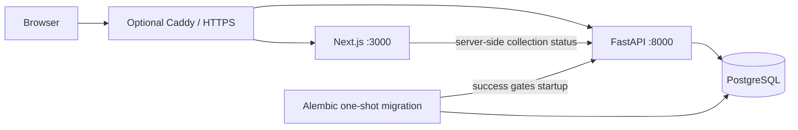

# TrendSky

**Discover what's rising.**

An independent social intelligence and predictive analytics project for public Bluesky conversations. Inspired by the simplicity of Google Trends, with a different data source: **observed conversation activity, not search interest**.

Milestone 1 implements the application foundation. No posts have been collected, no trends are ranked and no models are trained. [Implementation status](docs/IMPLEMENTATION-STATUS.md) records verification and outstanding acceptance checks.

## Foundation

- Original responsive homepage and Explore, Trending Now, Predictions and About routes.
- Blue Sky brand tokens, self-hosted Ubuntu Regular and persistent light/dark themes.
- Keyboard and touch search; topic queries survive navigation, URL sharing and reloads.
- Honest empty states and a separate state for an unavailable API.
- FastAPI liveness, database/schema readiness, collection summary and OpenAPI documentation.
- SQLAlchemy source registry, reversible Alembic migration and PostgreSQL configuration.
- Docker Compose, migration startup gate, non-root web/API containers and optional Caddy HTTPS.
- Python, TypeScript and Playwright tests; GitHub Actions validation and dependency auditing.

## Stack and boundaries

Next.js 16.4.3 / React 19.3.1 / TypeScript 6 / Tailwind 4, shadcn-style owned UI primitives, Radix Slot and Lucide. Python 3.14 / FastAPI 0.162 / Pydantic 2 / SQLAlchemy 2.1 / Alembic / Psycopg 3. PostgreSQL 18. Node 22 LTS.

Exact resolved versions are in `package-lock.json`, `requirements.lock` (runtime) and `requirements-dev.lock` (development). Compatibility was checked against official documentation, registry metadata, installation, type checks and the frontend build. The PostgreSQL container and Compose build still require runtime verification in an environment with Docker access. Charts, Spark, Delta Lake, Databricks and ML dependencies are deliberately deferred until they have implemented workloads.



## Run with Docker

Requires Docker Engine and Docker Compose with permission to access the daemon. Local ports 3000 and 8000 must be free.

1. Copy `.env.example` to `.env` **only if `.env` does not already exist**. For an existing file, merge the new keys manually.
2. Generate two distinct secrets with `openssl rand -hex 32`. Set `POSTGRES_PASSWORD` (database administrator) and `APP_DB_PASSWORD` (restricted application role). Leave secrets out of Git.
3. Run:

```bash
docker compose config --quiet
docker compose up --build -d --wait --wait-timeout 180
docker compose ps
curl --fail http://localhost:8000/api/v1/health
```

Open [localhost:3000](http://localhost:3000); API docs are at [localhost:8000/docs](http://localhost:8000/docs). The database is not exposed to the host. Migrations execute before the API starts; they never run in request handlers. Fresh database initialization creates `trendsky_app` without superuser/database/role creation privileges.

```bash
docker compose logs --tail=100 api web migrate
docker compose down
```

`down` preserves named volumes. Do not remove production volumes. Changing passwords in `.env` does not rotate roles in an already initialized database; see [deployment](docs/DEPLOYMENT.md).

## Local development

Requires Node 22+, Python 3.14 and a local/disposable PostgreSQL database. Install from the repository root:

```bash
npm ci
python3.14 -m venv .venv
.venv/bin/python -m pip install -r requirements-dev.lock
.venv/bin/python -m pip install --no-deps -e .
```

Configure `DATABASE_URL` for your PostgreSQL instance (URL-encode credentials), or configure `POSTGRES_HOST`, `POSTGRES_DB` and `APP_DB_PASSWORD`. Defaults never contain real credentials. With the database available:

```bash
.venv/bin/alembic upgrade head
.venv/bin/uvicorn trendsky_api.main:app --host 127.0.0.1 --port 8000 --reload
```

In a second terminal run `npm run dev`. Next.js loads its own environment files from `apps/web`, not the repository root. The web API URL defaults to `http://127.0.0.1:8000`; export `API_INTERNAL_URL` if different, or set it in `apps/web/.env.local`. Compose sets it automatically. The frontend remains usable for navigation when the API is unavailable and clearly reports that status.

## Verify

```bash
npm run lint
npm run typecheck
npm test
npm run build
npx playwright install chromium
npm run test:e2e
.venv/bin/ruff check apps/api tests/api
.venv/bin/ruff format --check apps/api tests/api
.venv/bin/mypy
.venv/bin/pytest -q
npm audit --audit-level=high
.venv/bin/python -m pip_audit -r requirements.lock --no-deps --disable-pip
```

Python tests use deterministic SQLite fixtures for transport and migration logic. PostgreSQL testing is separate: set `TEST_DATABASE_URL` to a **disposable** PostgreSQL database and run `pytest -m postgres`. That test downgrades and rebuilds its schema. It must never target application data. Normal CI needs no Bluesky connection. Playwright runs desktop Chromium and a Chromium mobile viewport; that is not a claim of physical iOS/Android testing. Set `PLAYWRIGHT_CHROMIUM_EXECUTABLE` to use an existing browser.

## Documentation and roadmap

[Architecture](docs/ARCHITECTURE.md) · [Design system](docs/DESIGN-SYSTEM.md) · [Data dictionary](docs/DATA-DICTIONARY.md) · [Security](docs/SECURITY.md) · [Deployment](docs/DEPLOYMENT.md) · [Engineering report](docs/MILESTONE-1-REPORT.md)

After Milestone 1 acceptance is verified, Milestone 2 is Jetstream ingestion with validation, deduplication, durable checkpoints, reconnect logic, deletion handling and collection coverage. Trend detection, Explore/Compare analytics, historical processing and ML follow in order. No paid cloud infrastructure is provisioned.

## Limitations

This foundation does not measure activity, offer semantic matching, compare topics, produce chart exports or predict trends. Disabled filters communicate unavailable history. Search currently implements navigation and query preservation only. No performance benchmark, model accuracy or production-readiness claim is made. Caddy and GitHub Actions are configured but local execution evidence is tracked separately.

## Author and font licence

Jerry Monteverde — personal portfolio project. Ubuntu fonts are distributed under the [Ubuntu Font Licence](apps/web/src/fonts/LICENSE.txt); bundled font binaries are unmodified. No affiliation with Google, Canonical or Bluesky is implied.
