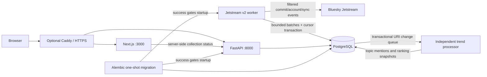

# TrendSky

**Discover what's rising.**

An independent social intelligence and predictive analytics project for public Bluesky conversations. Inspired by the simplicity of Google Trends, with a different data source: **observed conversation activity, not search interest**.

Milestones 1–2 established the illustrated application and public Bluesky collection. Milestone 3 implements deterministic topic discovery, coverage-aware statistics, persisted rankings and real-data frontend contracts. The existing ingestion API was observed collecting during development; applying and verifying the new PostgreSQL migration/worker requires Docker access. See [implementation status](docs/IMPLEMENTATION-STATUS.md) and the [Milestone 3 report](docs/MILESTONE-3-REPORT.md).

## Foundation

- Original responsive homepage and Explore, Trending Now, Predictions and About routes.
- Illustrated responsive sunset-terrace hero, suggested searches and an editorial collection status panel.
- Eighteen optional topic illustration crops and a reusable trend card that only displays supplied metrics.
- Refreshed Explore, Trending, Predictions and About pages with honest, data-free analytics states.
- Blue Sky brand tokens, self-hosted Ubuntu Regular and persistent light/dark themes.
- Keyboard and touch search; topic queries survive navigation, URL sharing and reloads.
- Honest empty states and a separate state for an unavailable API.
- FastAPI liveness, database/schema readiness, collection summary and OpenAPI documentation.
- Dedicated async Jetstream v2 ingestion worker with bounded buffering, batched writes, replay cursor, idempotent updates/deletes, account tombstones, operational counters, retention and coverage gaps.
- Durable public-post, normalized hashtag, checkpoint, collection-period and known-gap records via Alembic migration `0002_ingestion`.
- Read-only ingestion status, statistics and bounded coverage API endpoints; homepage status is sourced from worker heartbeat and database counts.
- Incremental hashtag, English/Spanish keyword and curated phrase discovery, with transactional edit/delete/retention correction.
- Popular Now, Rising Fast and Emerging snapshots for 5 minutes, 15 minutes, 1 hour, 6 hours and 24 hours. Growth is withheld when comparable collection coverage is unavailable.
- Illustrated measured topic cards, language/window controls and a basic topic activity history. Artwork maps only to reviewed exact labels.
- SQLAlchemy source registry, reversible Alembic migration and PostgreSQL configuration.
- Docker Compose, migration startup gate, non-root web/API containers and optional Caddy HTTPS.
- Python, TypeScript and Playwright tests; GitHub Actions validation and dependency auditing.

The 1920 × 640 hero is a 202 KB WebP. The eighteen 352 × 194 topic crops total 348 KB. The full illustrated dashboard reference is never rendered as UI. See [illustration guidelines](docs/ILLUSTRATION-GUIDELINES.md).

## Stack and boundaries

Next.js 16.4.3 / React 19.3.1 / TypeScript 6 / Tailwind 4, shadcn-style owned UI primitives, Radix Slot and Lucide. Python 3.14 / FastAPI 0.162 / Pydantic 2 / SQLAlchemy 2.1 / Alembic / Psycopg 3. PostgreSQL 18. Node 22 LTS.

Exact resolved versions are in `package-lock.json`, `requirements.lock` (runtime) and `requirements-dev.lock` (development). Compatibility was checked against official documentation, registry metadata, installation, type checks and the frontend build. The PostgreSQL container and Compose build still require runtime verification in an environment with Docker access. Charts, Spark, Delta Lake, Databricks and ML dependencies are deliberately deferred until they have implemented workloads.



## Run with Docker

Requires Docker Engine and Docker Compose with permission to access the daemon. Local ports 3000 and 8000 must be free.

1. Copy `.env.example` to `.env` **only if `.env` does not already exist**. For an existing file, merge the new keys manually.
2. Generate two distinct secrets with `openssl rand -hex 32`. Set `POSTGRES_PASSWORD` (database administrator) and `APP_DB_PASSWORD` (restricted application role). Leave secrets out of Git.
3. Run:

```bash
docker compose config --quiet
docker compose up --build -d --wait --wait-timeout 180 db migrate ingestion trends api web
docker compose ps
curl --fail http://localhost:8000/api/v1/health
```

Open [localhost:3000](http://localhost:3000); API docs are at [localhost:8000/docs](http://localhost:8000/docs). The database is not exposed to the host. Migrations execute before the API starts; they never run in request handlers. Fresh database initialization creates `trendsky_app` without superuser/database/role creation privileges.

```bash
docker compose logs --tail=100 api web migrate ingestion trends
curl --fail http://localhost:8000/api/v1/ingestion/status
curl --fail http://localhost:8000/api/v1/ingestion/stats
curl --fail 'http://localhost:8000/api/v1/ingestion/coverage?limit=20'
curl --fail 'http://localhost:8000/api/v1/trending?category=popular&window=5&language=all'
curl --fail http://localhost:8000/api/v1/trending/status
docker compose down
```

`down` preserves named volumes. Do not remove production volumes. Changing passwords in `.env` does not rotate roles in an already initialized database; see [deployment](docs/DEPLOYMENT.md).

## Local development

Requires Node 22+, Python 3.14 and a local/disposable PostgreSQL database. Install from the repository root:

```bash
npm ci
python3.14 -m venv .venv
.venv/bin/python -m pip install -r requirements-dev.lock
.venv/bin/python -m pip install --no-deps -e .
```

Configure `DATABASE_URL` for your PostgreSQL instance (URL-encode credentials), or configure `POSTGRES_HOST`, `POSTGRES_DB` and `APP_DB_PASSWORD`. Defaults never contain real credentials. With the database available:

```bash
.venv/bin/alembic upgrade head
.venv/bin/uvicorn trendsky_api.main:app --host 127.0.0.1 --port 8000 --reload
```

In a second terminal run `npm run dev`. Next.js loads its own environment files from `apps/web`, not the repository root. The web API URL defaults to `http://127.0.0.1:8000`; export `API_INTERNAL_URL` if different, or set it in `apps/web/.env.local`. Compose sets it automatically. The frontend remains usable for navigation when the API is unavailable and clearly reports that status.

## Verify

```bash
npm run lint
npm run typecheck
npm test
npm run build
npx playwright install chromium
npm run test:e2e
.venv/bin/ruff check apps/api tests/api
.venv/bin/ruff format --check apps/api tests/api
.venv/bin/mypy
.venv/bin/pytest -q
npm audit --audit-level=high
.venv/bin/python -m pip_audit -r requirements.lock --no-deps --disable-pip
```

Python tests use deterministic SQLite fixtures for transport and migration logic. PostgreSQL testing is separate: set `TEST_DATABASE_URL` to a **disposable** PostgreSQL database and run `pytest -m postgres`. That test downgrades and rebuilds its schema. It must never target application data. Normal CI needs no Bluesky connection. Playwright runs desktop Chromium and a Chromium mobile viewport; that is not a claim of physical iOS/Android testing. Set `PLAYWRIGHT_CHROMIUM_EXECUTABLE` to use an existing browser.

## Documentation and roadmap

[Architecture](docs/ARCHITECTURE.md) · [Design system](docs/DESIGN-SYSTEM.md) · [Illustration guidelines](docs/ILLUSTRATION-GUIDELINES.md) · [Data dictionary](docs/DATA-DICTIONARY.md) · [Security](docs/SECURITY.md) · [Deployment](docs/DEPLOYMENT.md) · [Milestone 1.5 report](docs/MILESTONE-1.5-REPORT.md)

Full Explore/Compare analytics, historical processing and ML follow this statistical ranking milestone. Jetstream data is public Bluesky conversation data, not Google search interest or a complete view of Bluesky history. Collection begins at worker startup; known outages and invalid frames are represented as coverage gaps, not zero activity. Data is retained for 30 days by default. No paid cloud infrastructure is provisioned.

## Limitations

Topic discovery and measured activity are implemented. Semantic matching, full topic comparison, chart exports and prediction remain later milestones. The basic Explore summary resolves exact discovered topics and links from trend cards. Both SQLite and isolated PostgreSQL 18 validation are recorded, including actual PostgreSQL plans and transaction/trigger tests. Production performance and repaired live collection remain unverified. Caddy and GitHub Actions execution evidence is tracked separately.

## Update an existing collecting installation

For the current ingestion incident, follow the complete [Milestone 3.1 recovery procedure](docs/MILESTONE-3.1-RECOVERY-REPORT.md). Docker permissions blocked deployment during this execution; recovery is **not complete**. The existing backup archive is zero bytes. Create and validate a new backup before operational changes; never reset the checkpoint or recreate the database.

The repair covers NUL-bearing post text, language metadata and hashtag facets. It adds safe JSON diagnostics, classified retries, a durable operator hold for deterministic faults, and separate health signals for ingestion/analysis/database readiness. It preserves the design and existing atomic source/queue/checkpoint transaction. No new migration is required at revision `0003_trends`. The following are build/read-only inspection commands, not proof of recovery:

```bash
docker compose build api ingestion trends web
docker compose run --rm --no-deps api python -m trendsky_api.operations
docker compose run --rm --no-deps api alembic current
```

After backup/schema inspection, the runbook restores ingestion first, observes at least 180 seconds, resumes bounded trend processing and verifies another controlled ingestion restart. `scripts/verify_recovery.py` checks actual API progress without changing state. The default processor handles batches of 500, pauses 0.25 seconds between backlogged batches (`TRENDS_BATCH_PAUSE_SECONDS`), publishes every 60 seconds, has a 384 MiB/0.5 CPU Compose limit, and uses a small database pool.

Recovery validation passed 84 backend tests (including PostgreSQL), 22 frontend unit tests and 26 browser tests. The [25,000-post PostgreSQL artifact](docs/evidence/milestone-3.1-postgres.json) records median/p95 batch latency of 149/417 ms on a private tmpfs test cluster; these are not production throughput guarantees. See [incident analysis](docs/INGESTION-INCIDENT-ANALYSIS.md) and [implementation status](docs/IMPLEMENTATION-STATUS.md) for evidence and remaining gates.

Run isolated analytical validation without Bluesky or operational database access:

```bash
.venv/bin/python scripts/validate_trends.py --posts 25000
```

See [methodology](docs/TREND-METHODOLOGY.md) for formulas, thresholds, language limitations and contributor caps. Browser CI uses a synthetic test-only HTTP fixture; it does not contact Bluesky or substitute sample data in the application.

## Author and font licence

Jerry Monteverde — personal portfolio project. Ubuntu fonts are distributed under the [Ubuntu Font Licence](apps/web/src/fonts/LICENSE.txt); bundled font binaries are unmodified. No affiliation with Google, Canonical or Bluesky is implied.
