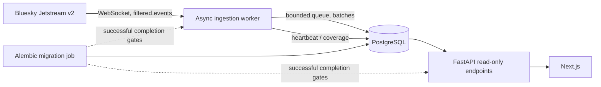
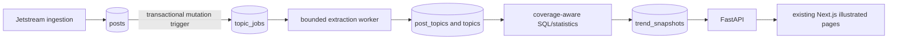

# Architecture

## Runtime boundaries

- `apps/web`: Next.js pages and client interactions. Server-side page rendering calls the internal API; the browser never receives database credentials.
- `apps/api`: FastAPI read-only public contracts and operational database queries. It does not run a socket reader, Spark job, or model training in request handlers.
- `apps/api/trendsky_api/ingestion`: a dedicated Compose process reads the filtered Bluesky Jetstream v2 stream, validates frames and performs bounded, batched SQL transactions. Packaging shares the Python image while the process remains independent of HTTP serving.
- PostgreSQL: operational post, normalized hashtag, checkpoint, cumulative metric and coverage state.
- Alembic: `migrate` one-shot service must complete successfully before API or worker start.
- `infrastructure`: isolated TrendSky container definitions and optional Caddy profile. The ingestion worker has no host port.

## Ingestion and recovery

The worker uses the v2 `/xrpc/network.bsky.jetstream.subscribeEvents` interface and `xrpc.v1.json` subprotocol, collecting only `app.bsky.feed.post` commit events plus account and sync markers needed to honor removals. JSON frames must use the v2 `message` envelope. A bounded asyncio queue and WebSocket receive queue apply backpressure; configured batch writes are persisted with the highest safely processed sequence in the same transaction. AT URI is the stable post key. The inclusive replay cursor may deliver the final committed event again, which is handled idempotently.

Reconnect uses exponential backoff with jitter. A cursor-too-old response or info frame creates a known gap and blocks automatic restart until an operator assesses recovery; the service does not claim continuity or perform historical backfill. Worker heartbeat freshness, not the last status label alone, controls the public effective status. See [data architecture](DATA-ARCHITECTURE.md) and [Milestone 2 report](MILESTONE-2-REPORT.md).

## Database/API behavior

`/api/v1/health` checks database, source seed and Alembic revision. `/api/v1/ingestion/status`, `/stats`, `/coverage`, and the existing summary are read-only. Status includes current retained row count separately from cumulative worker counters. Database failures return safe 503 messages. No raw infrastructure configuration is exposed.

## Dependency and deployment boundaries

PostgreSQL is the operational store. Worker and API use small connection pools; ingestion is limited to 384 MiB and one CPU in Compose. It has no published port, waits for healthy PostgreSQL and successful migrations, and uses restart policy plus graceful shutdown. The website remains independent of Jetstream availability. The statistical trend processor is described below; historical processing, Spark, Databricks and ML remain later work. No paid cloud infrastructure is provisioned.

## Milestone 3 analytical boundary

`trendsky_api.trends` is a separate process, deployed as the `trends` Compose service. It shares the operational schema but has no host port. It extracts topics from a persistent URI work queue, then publishes indexed ranking snapshots. FastAPI reads those snapshots and the topic registry; it never launches extraction or aggregation while serving a page.

A row in `topic_jobs` has a URI, generation and timestamp. It stores no deleted text. Insert/update/delete triggers cover direct source changes, account/sync purges and retention; a sequence-only checkpoint would miss those deletes. Existing observations are queued once when the migration is applied. Trigger capture is installed before seeding, under the migration's short DDL lock, to prevent a backfill/change-capture race.

The processor claims bounded jobs and uses `SKIP LOCKED` for source/topic contention, short lock timeouts and a transaction advisory lock to coordinate analytical workers. It replaces mentions and removes acknowledged jobs in one transaction. Snapshot publication captures topic revisions before reading aggregates, then rechecks under topic locks. Source edits/deletes invalidate affected historical results in their source transaction. New records after a saved event-time boundary preserve that earlier snapshot.

PostgreSQL `GROUPING SETS` produces per-language and all-language contributor groups in one bounded aggregate query per window. A portable union equivalent supports deterministic SQLite tests. Contributor counts are distinct across the whole window, including across languages. Candidate/topic caps, indexed event-time ranges and query deadlines bound work. SQLite execution and PostgreSQL runtime verification are recorded separately in the milestone report.

## Milestone 3.1 reliability boundary

Persistence normalizes all supported free-text/JSON strings at the database boundary and validates stable identifiers. The same source transaction still commits post/hashtag changes, trigger jobs, counters and checkpoint. No schema change was necessary. Deterministic persistence faults create a bounded, content-free operator-review marker in existing operational state and a coverage limitation; automatic replay holds without advancing the cursor, including after restart. This deliberately favors data integrity over availability when a record cannot be durably processed. No content quarantine or automatic historical backfill is claimed.

Workers use allowlisted JSON diagnostics and safe error classification. Transient database failures receive bounded per-batch retries and connection recovery. Logs exclude driver messages, SQL/parameters, source text and credentials. `python -m trendsky_api.operations` performs read-only, deadline-bounded catalog inspection without exposing active SQL or individual observations.

Ingestion health uses heartbeat **and recent durable writes**, independently of trend freshness/backlog. A new socket can be processing while persistence is not yet proven. Stopped/delayed/error analysis cannot publish current rankings. `/health` distinguishes unavailable connectivity from degraded schema readiness. Catch-up remains bounded at the configured batch size and `TRENDS_BATCH_PAUSE_SECONDS`; no additional process or public administrative endpoint was introduced.

Actual isolated PostgreSQL 18 tests and measurements now supplement the earlier SQLite evidence. Operational recovery remains unverified because Docker permissions were unavailable. See [recovery report](MILESTONE-3.1-RECOVERY-REPORT.md) for backup checks, deployment, sustained verification and remaining acceptance gates.
